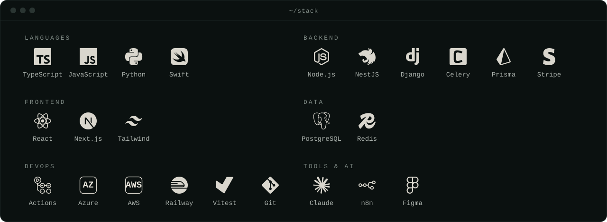

  

  
  
  
  

 

  

  

plain text

**Isai Almeraz** · Full-Stack Software Engineer focused on web platforms, CI/CD and automation.

- **FA360** (ASAP LLC) · Student services and financial aid platform. 6 institutions, 30+ sprints, 13 automations saving ~6–7 h/week. Django, DRF, PostgreSQL, Celery, React, TypeScript, GitHub Actions, Azure Pipelines.
- **Sokio** ([mndwrk](https://mndwrk.co)) · Gym and fitness studio management SaaS, pre-launch. Multi-tenant with PostgreSQL row-level security and Stripe billing. NestJS, Prisma, Redis, Next.js. [sokio.app](https://sokio.app)
- **Helen** · Sign-language assistant for the deaf community. Custom LSTM model on Raspberry Pi; technical article in progress.

B.S. Software Engineering, UABC (Dec 2026) · English (C1), Spanish (native) · Open to full-stack and DevOps-leaning roles.

