  
  
  
  
  

### Full-Stack Software Engineer

I build web platforms end to end, and the pipelines that ship them.

### Now

- **ASAP LLC (FA360)** · Software Developer & Project Manager on a student services and financial aid platform used by 6 institutions. Co-designing the platform rebuild (Django, DRF, PostgreSQL, Celery · React, TypeScript) and owning CI/CD in GitHub Actions and Azure Pipelines.
- **[mndwrk](https://mndwrk.co)** · Co-founder. Building [Sokio](https://sokio.app), a multi-tenant SaaS for gyms and fitness studios (NestJS, Prisma, PostgreSQL with Row-Level Security, Next.js).
- **Helen** · Writing a technical article on a sign-language assistant powered by a custom LSTM model on Raspberry Pi.

### Stack

  

  

---

Open to full-stack and DevOps-leaning roles · [contact@almerazisai.com](mailto:contact@almerazisai.com)
